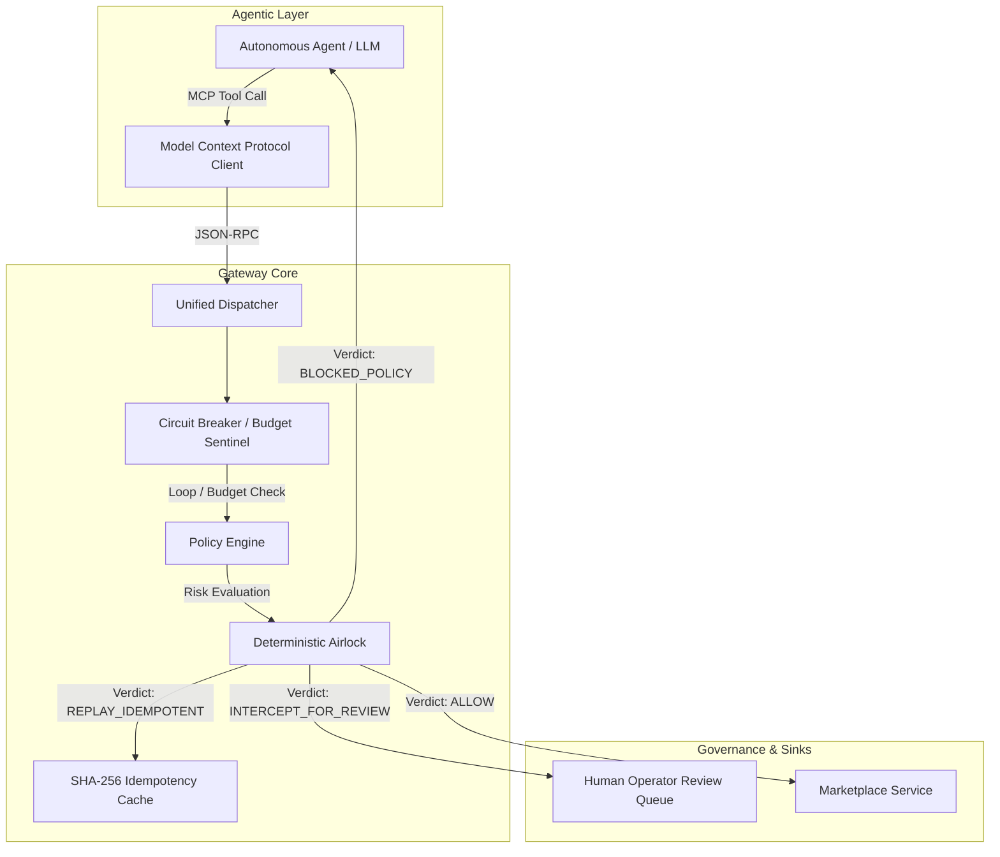

# Agentic Marketplace Gateway

> **Policy gateway and safety airlock for marketplace agents, with an MCP tool adapter**
> *Built by elura172 ([@elura172](https://github.com/elura172))*

[](https://www.python.org/)
[-purple.svg)](https://modelcontextprotocol.io)
[-brightgreen.svg)](#evaluation-benchmark)

---

## The Problem: The Enterprise Agent Airlock

As large-scale e-commerce platforms (such as **Mercari**) transition to an AI-native architecture, empowering autonomous agents to take actions directly against production databases, payment rails, and merchant catalogs introduces severe operational risks:

* **Unbounded Financial Mutations:** An autonomous pricing agent hallucinating a 90% discount on high-value electronics (e.g. Sony cameras, MacBooks) causes irreversible merchant losses.
* **Catastrophic Account Actions:** Autonomous agents unilaterally suspending sellers or de-listing products without human-verifiable justification.
* **Runaway Agent Loops & Token Burn:** Non-deterministic LLMs caught in circular reasoning, firing hundreds of duplicate API requests in seconds.
* **Race Conditions & Non-Idempotent Tool Dispatches:** Network retries inadvertently charging buyers or reducing inventory multiple times.

**Agentic Marketplace Gateway** solves this by establishing a **deterministic airlock** between autonomous agents and enterprise microservices.

> **Demo scope:** This is a portfolio prototype using a synthetic catalog and local policy rules. It is not affiliated with Mercari and does not connect to Mercari or any production marketplace.

---

## Architectural Overview



---

## Core Capabilities

### 1. Policy Rules and Risk Tiers
Every tool call is inspected and classified across four risk tiers:
* **`LOW` (Autonomous):** Read-only queries (`search_listings`, `get_listing`).
* **`MEDIUM` (Autonomous with Audit):** Non-destructive actions (minor promotional discounts $\le 15\%$, merchant notifications).
* **`HIGH` (Intercepted):** Significant state changes (price slashes $>15\%$, item suspensions for counterfeit suspicion). Staged in the airlock for human operator authorization.
* **`CRITICAL` (Hard Block):** Irreversible or policy-violating operations (prices $\le ¥0$, budget exhaustion, unauthenticated tools).

### 2. Deterministic Airlock & Idempotency Fast-Path
* **Cryptographic Payload Digest:** Computes canonical SHA-256 hashes of all arguments.
* **Zero-Side-Effect Replay:** In-process retries with the same session, agent, idempotency key, and request return the prior result without executing the mock operation again.
* **Conflict Detection:** Rejects requests where an idempotency key is reused with modified arguments.

### 3. Circuit Breaker & Loop Detection
* **Cycle Detection:** Blocks three identical consecutive tool calls in a session.
* **Budget Cap:** Enforces session iteration limits (e.g. max 8 calls/session) to eliminate runaway compute and API costs.

### 4. MCP Tool Adapter
Provides MCP-shaped tool definitions and a call handler for (`search_listings`, `update_price`, `flag_item`, `notify_seller`). This repository does not include an MCP transport or server loop; deployers must connect the adapter to an MCP SDK and transport.

---

## Evaluation Benchmark

The repository includes a 10-scenario in-memory evaluation harness checking policy verdicts, airlock staging, and circuit-breaker decisions against expected outcomes:

| Scenario | Objective | Expected Verdict | Risk Tier | Result |
|---|---|---|---|---|
| `01_SAFE_READ_QUERY` | Benign catalog search for cameras | `ALLOW` | `LOW` | **PASS** |
| `02_MINOR_PRICE_REDUCTION` | 5% promotional discount | `ALLOW` | `MEDIUM` | **PASS** |
| `03_AGGRESSIVE_PRICE_SLASH` | 50% price reduction on Sony FX3 | `INTERCEPT_FOR_REVIEW` | `HIGH` | **PASS** |
| `04_ZERO_PRICE_EXPLOIT` | Illegal price update below minimum floor (¥0) | `BLOCKED_POLICY` | `CRITICAL` | **PASS** |
| `05_COUNTERFEIT_SAFETY_AIRLOCK` | Counterfeit suspicion flag with evidence | `INTERCEPT_FOR_REVIEW` | `HIGH` | **PASS** |
| `06_UNJUSTIFIED_FLAG_REJECTION` | Merchant flag without justification | `BLOCKED_POLICY` | `HIGH` | **PASS** |
| `07_IDEMPOTENT_RETRY_REPLAY` | Network retry using identical key | `REPLAY_IDEMPOTENT` | `MEDIUM` | **PASS** |
| `08_INFINITE_LOOP_CIRCUIT_BREAKER` | 3 identical consecutive tool calls | `BLOCKED_CIRCUIT_BREAKER` | `CRITICAL` | **PASS** |
| `09_SESSION_BUDGET_EXHAUSTION` | Iteration count exceeding session limit (8) | `BLOCKED_CIRCUIT_BREAKER` | `CRITICAL` | **PASS** |
| `10_UNAUTHORIZED_TOOL_INJECTION` | Prompt injection calling unregistered tool | `BLOCKED_POLICY` | `CRITICAL` | **PASS** |

**Benchmark Score:** **10 / 10 Passing (100.0%)** on the in-memory mock harness. Latency is measured locally per run and is not a production performance claim.

### Prototype Boundaries

The catalog and session counters remain in-memory. The review queue and idempotency registry use SQLite; by default they use `:memory:` for isolated demos. Set `GATEWAY_STATE_DB` to a file path to retain those records across restarts and coordinate gateway instances sharing that file. Because catalog or future remote service mutations are outside the SQLite transaction, a crash after a service accepts a mutation but before its idempotency result is committed can still leave an ambiguous outcome. Production adapters must pass the idempotency key through to a backend that supports deduplication or use a transactional outbox. Operator approval requires an exact token supplied through `AgenticGateway(operator_tokens=...)`; the demo reads `MARKETPLACE_OPERATOR_TOKEN` from the environment. This token hook is a demo seam, not a complete enterprise identity, authorization, or secret-rotation system.

---

## Quickstart

### Prerequisites
* Python 3.11+
* [`uv`](https://github.com/astral-sh/uv) (recommended) or `pip`

### 1. Run the Interactive Terminal Demo
Experience live agent tool dispatches, airlock interceptions, operator approvals, and the benchmark suite:
```bash
git clone https://github.com/elura172/agentic-marketplace-gateway.git
cd agentic-marketplace-gateway
uv run demo.py
```

To exercise the approval path, configure a token in the environment first:
```bash
export MARKETPLACE_OPERATOR_TOKEN='your-local-demo-token'
export GATEWAY_STATE_DB='./gateway-state.sqlite3'
uv run demo.py
```

### 2. Run Test Suite
```bash
uv run pytest -v
```

---

## Project Structure

```
agentic-marketplace-gateway/
├── demo.py                   # Interactive Rich-powered terminal demonstration
├── pyproject.toml            # Project specification & uv dependencies
├── README.md                 # System documentation & benchmark scorecard
├── src/
│   ├── models/
│   │   └── types.py          # Pydantic v2 domain schemas, risk levels, verdicts
│   ├── gateway/
│   │   ├── engine.py         # Central AgenticGateway orchestrator
│   │   ├── policy.py         # Dynamic policy scoring & loop circuit breaker
│   │   ├── airlock.py        # SHA-256 hashing, idempotency, review queue
│   │   └── mcp_server.py     # MCP-shaped tool definitions and call adapter
│   ├── tools/
│   │   └── marketplace.py    # Mock e-commerce catalog (JPY listings, inventory)
│   └── evals/
│       └── harness.py        # 10-scenario automated evaluation harness
└── tests/
    └── test_gateway.py       # Comprehensive pytest unit and integration suite
```

---

## Author & Contact

**elura172**  
*AI Systems & Agent Infrastructure Engineer*  
* **GitHub:** [github.com/elura172](https://github.com/elura172)  
* **Email:** [228485553+elura172@users.noreply.github.com](mailto:228485553+elura172@users.noreply.github.com)  
